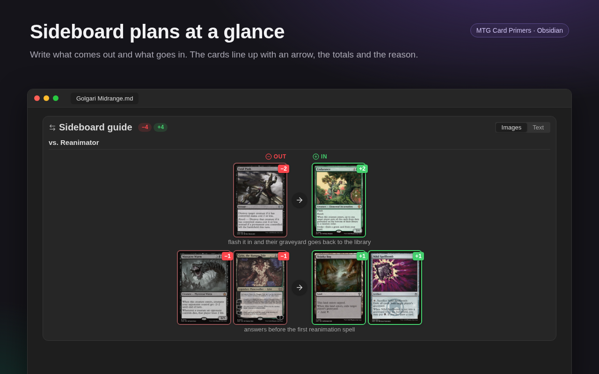
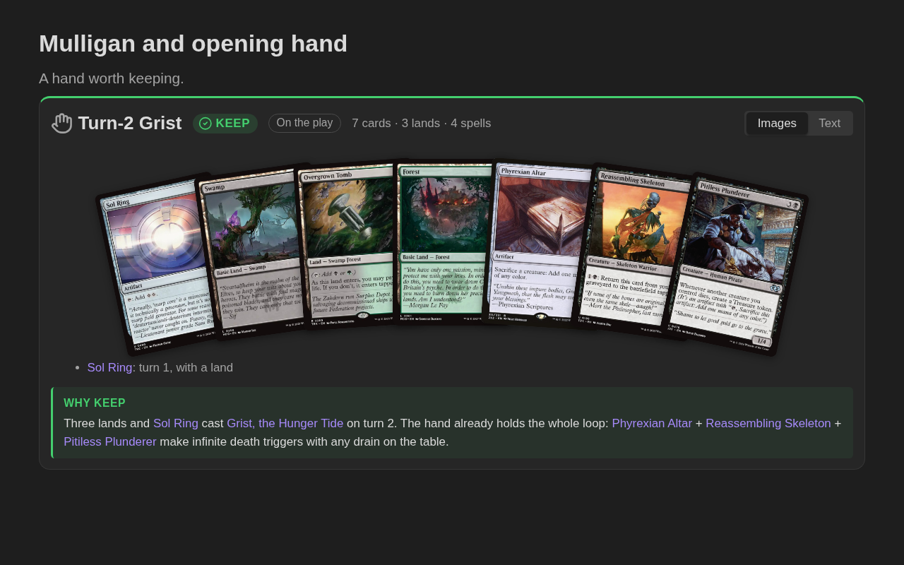
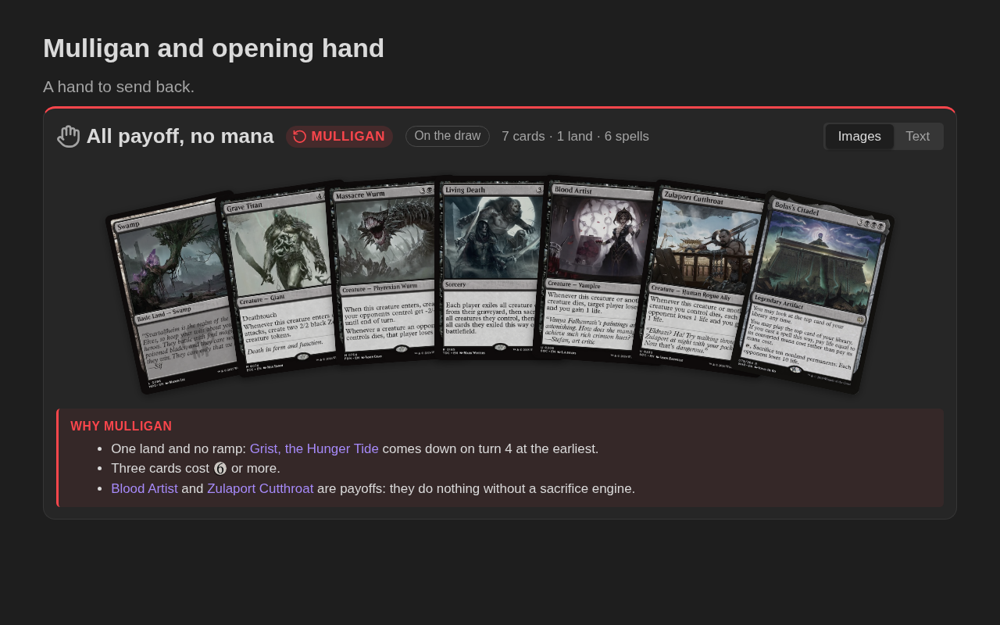
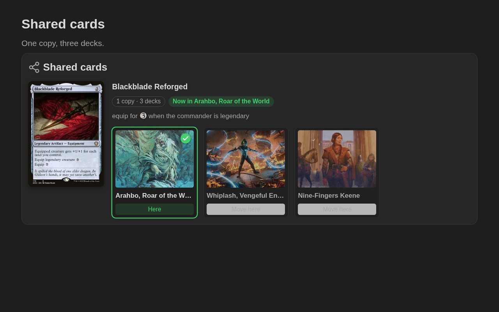
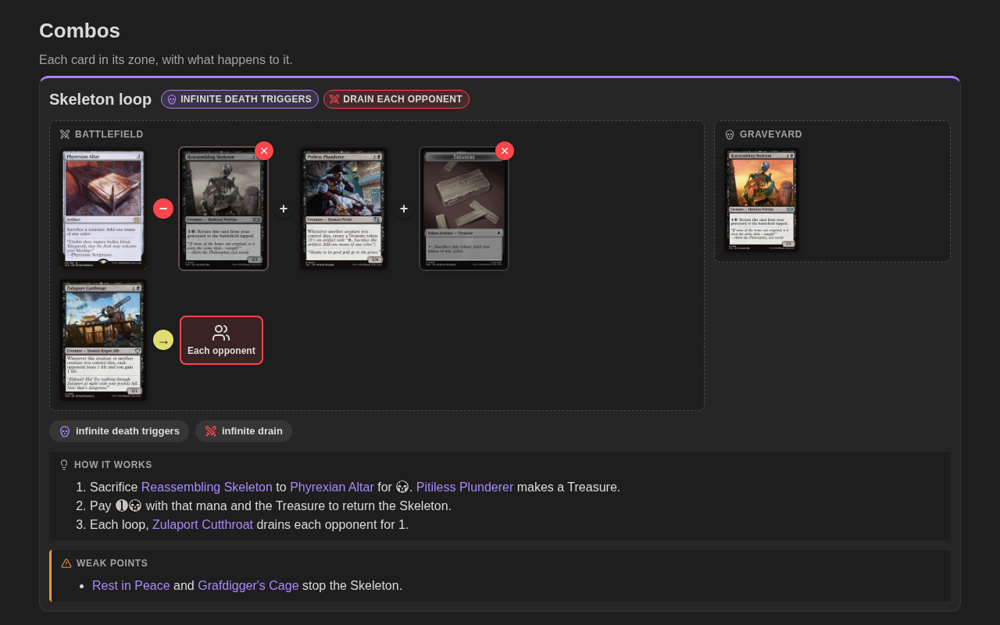
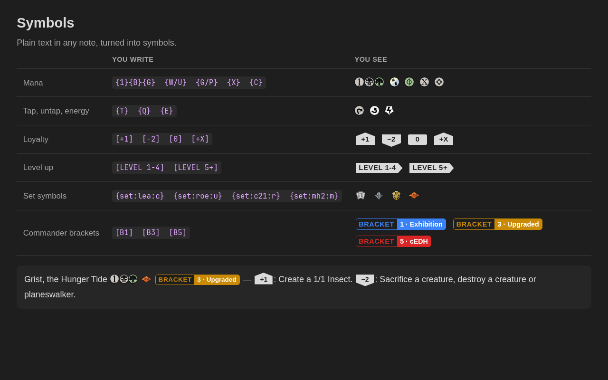

# MTG Card Primers

   

---

Write study notes ("primers") for Magic: The Gathering cards and decks, right in your vault.

MTG Card Primers treats your Magic knowledge the way Obsidian treats everything else: as plain Markdown notes you own. Decklists, combos and sideboard plans are short text blocks inside your notes, so they stay readable without the plugin, and the card data and images come from [Scryfall](https://scryfall.com).

## Feature Highlights

### 📝 Card primers

Run **New card primer**, pick a card, and you get a note made from your template, with the card's data saved in the frontmatter. Every printing of a card shares the same primer, so you never end up with duplicates. Find cards by name, by pasting a Moxfield line (`1 Sol Ring (C21) 263`), or by their name in another language (`Anel Solar`).

### 🏰 Deck primers

**New deck primer** asks for a commander and creates a note ready to fill in: the decklist, how the deck wins, combos, tutors, the opening hands to keep or mulligan, what shuts it down and a log of the changes you make.

### 🃏 Decklists

Paste a list from Moxfield, Arena or MTGO into an `mtg-deck` block and see it as a text list, stacks of cards or a grid of whole cards, sorted by type, name, mana value or colour. Pick the edition of each card, mark your foils, and click a card to open its primer in the side panel while the deck stays in view.

### 🔄 Sideboard and deck changes

Write `Fabled Passage -> Verdant Catacombs` in an `mtg-sideboard` or `mtg-changes` block and see what comes out of the deck and what goes in, with an arrow between the cards, the totals and the reason for each change. Group the changes by matchup, or keep a dated log of your deck.

### ✋ Opening hands

List seven cards in an `mtg-hand` block, write `keep` or `mulligan` and why, and see the hand fanned out with a green Keep or red Mulligan badge and its count of lands and spells. Show which hands your deck keeps and which it sends back.

| Keep | Mulligan |
|---|---|
|  |  |

### 🔗 Shared cards

Own one Blackblade Reforged for three decks? List the card and the decks that share it in an `mtg-shared` block, and mark the deck that has it now. Each deck shows its commander's art, and **Move here** updates the note when the card changes decks.

### ♾️ Combos

The `mtg-combo` block draws a combo the way it sits on the table: each card in its zone (battlefield, graveyard, stack…), with sacrificed and tapped cards marked, targets and tokens. Add the result, how it works and its weak points, in Markdown.

### 🔮 Symbols

Write `{1}{B}`, `{T}`, `[+1]`, `{set:dsc:m}` or `[BRACKET 3]` in any note and they turn into mana symbols, loyalty shields, set symbols and Commander bracket badges.

### 👁️ Hover previews

Hover a `[[Card name]]` link and the card appears, even if you haven't written a primer for it yet.

### 🖼️ Insert into notes

Insert a card's text, its art, the full card image of any edition, or its set symbol at the cursor, as plain Markdown.

> [!TIP]
> Each feature has its own page with every option and many examples:
> [primers and commands](docs/primers.md) ·
> [decklists](docs/decklists.md) ·
> [sideboard and deck changes](docs/sideboard.md) ·
> [opening hands](docs/hands.md) ·
> [shared cards](docs/shared.md) ·
> [combos](docs/combos.md) ·
> [symbols and hover previews](docs/symbols.md).

## Installation

### Obsidian community directory

MTG Card Primers is in the Obsidian community plugin directory. Open **Settings → Community plugins → Browse**, search for **MTG Card Primers**, then install and enable it.

You can also see the listing at https://community.obsidian.md/plugins/mtg-card-primers

### Manual

1. Download `main.js`, `manifest.json` and `styles.css` from the [latest release](https://github.com/diogoleal/mtg-card-primers/releases/latest).
2. Create the folder `<your vault>/.obsidian/plugins/mtg-card-primers/`.
3. Copy the three files into that folder.
4. Reload Obsidian and enable MTG Card Primers in **Settings → Community plugins**.

## Getting started

1. Open the command palette (`Ctrl/Cmd+P`) and run **New card primer**.
2. Type a card name and pick it. The primer is created in `MTG/Primers` and opens.
3. Write about the card. In any note, `[[Card name]]` links show the card on hover, and `{2}{U}` becomes mana symbols.
4. For a deck, run **New deck primer**, pick your commander and paste the rest of the list under `Deck`.

The folders and templates can be changed in **Settings → MTG Card Primers**.

> [!NOTE]
> The plugin only sends card lookups to Scryfall (names, set codes, card ids). Your notes are never sent. Images are links to Scryfall; nothing is downloaded into your vault. Details in [Development](docs/development.md#how-the-plugin-uses-scryfall).

## License

[MIT](LICENSE)
