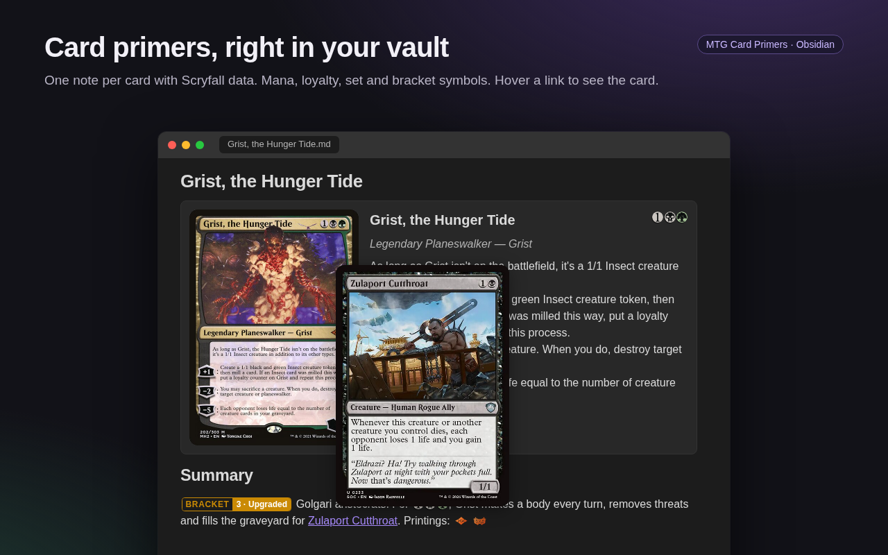
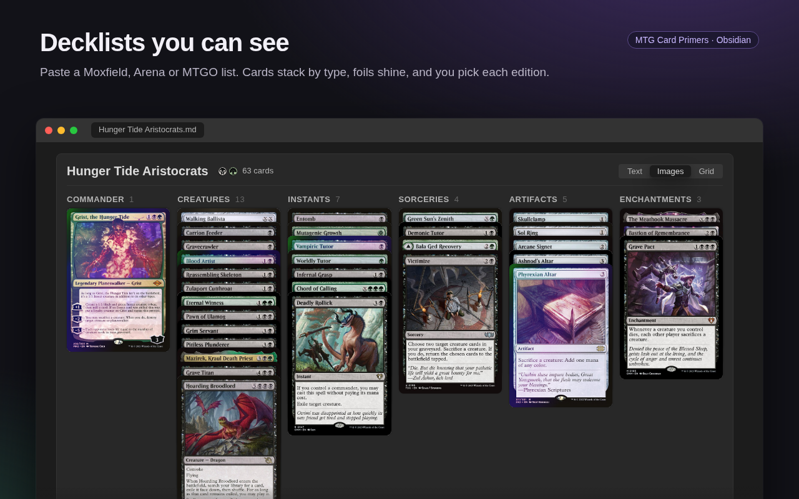
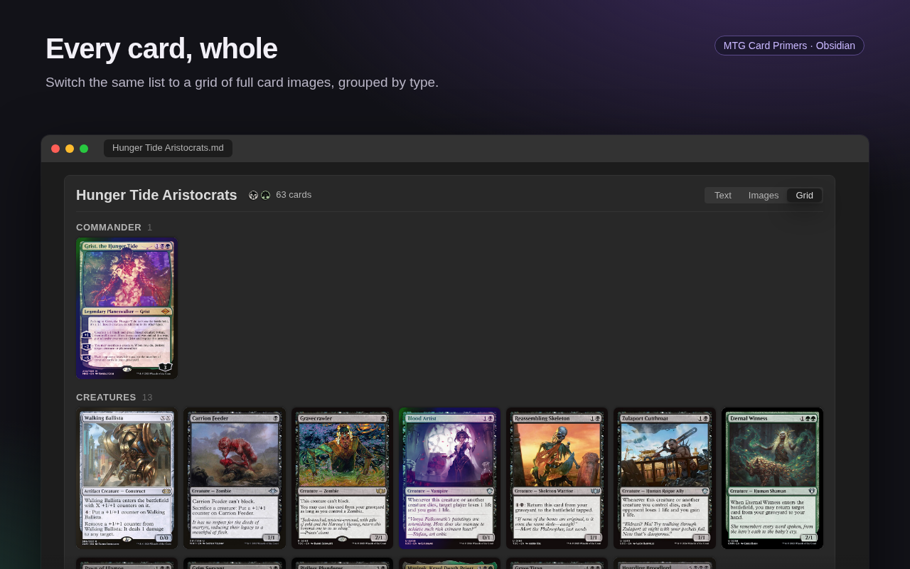
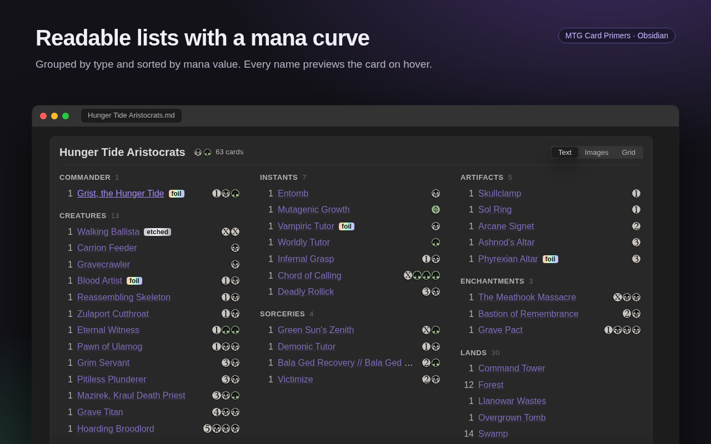
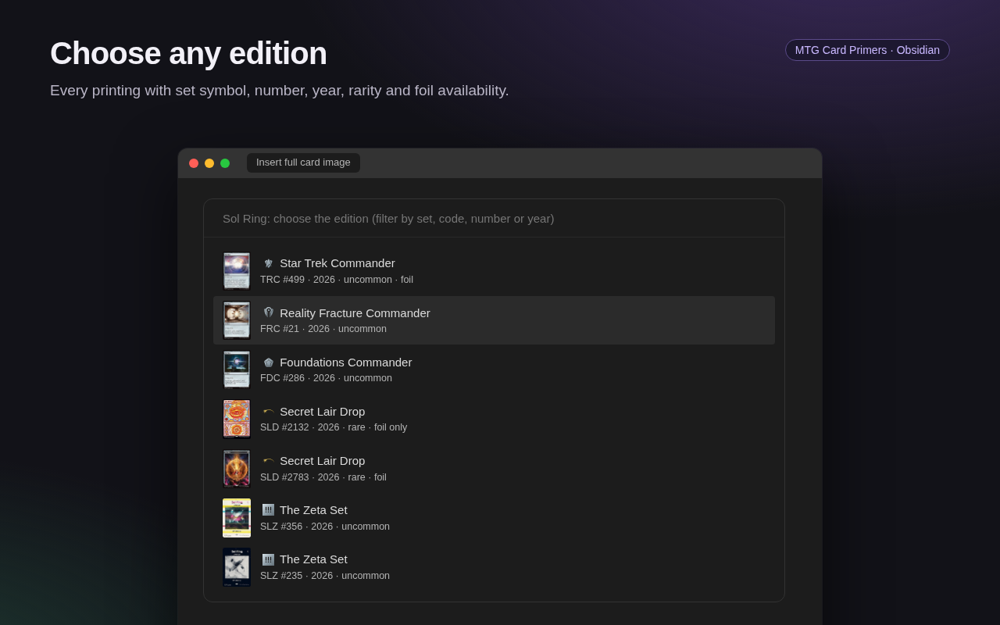

# MTG Card Primers

Keep your Magic: The Gathering knowledge in Obsidian. Write a study note ("primer") for each card, paste your decklists and see them as cards, and use mana, loyalty and set symbols anywhere in your notes. Card data and images come from [Scryfall](https://scryfall.com).



## Features

**Card primers**
- **One note per card**, created from your template, with the card data saved in the frontmatter. Every printing of a card shares the same primer (it is keyed by `oracle_id`), and opening a card that already has one opens it instead of making a duplicate.
- **Find any card:** by name with autocomplete, by pasting a Moxfield line (`1 Sol Ring (C21) 263 *F*`), or by its name in any language (`Anel Solar`, `Sonnenring`).
- **Hover previews:** hovering a `[[Card name]]` link shows the card.

**Decklists**
- **`mtg-deck` block:** paste a list from Moxfield, Arena or MTGO and switch between a text list, stacks of cards or a grid of whole cards, with colour identity and mana curve.
- **Your editions and foils:** pick the edition of each card and mark foils (`*F*`) and etched foils (`*E*`); the choice is saved in the note.
- **Edit primers beside the deck:** click a card to open its primer in the side panel (created on the spot if it doesn't exist yet), with the deck still in view.



**In any note**
- **Symbols:** mana `{1}{B}`, tap `{T}`, loyalty `[+1]`, level `[LEVEL 1-4]`, set symbols `{set:dsc:m}` and Commander brackets `[BRACKET 3]`.
- **Insert commands:** a card's text, its art, the full card image of any edition, or its set symbol.
- **`mtg-card` block:** a card with image, cost, type and text inside a note; works offline from the primer's saved data.

| Grid view | Text view | Edition picker |
|---|---|---|
|  |  |  |

### Syntax cheat sheet

| Write | Shows |
|---|---|
| `{1}{B}{G}`, `{W/U}`, `{G/P}`, `{X}`, `{C}` | mana symbols |
| `{T}`, `{Q}`, `{E}`, `{PW}` | tap, untap, energy, planeswalker |
| `[+1]`, `[−2]` / `[-2]`, `[0]`, `[+X]` | loyalty shields |
| `[LEVEL 1-4]`, `[LEVEL 5+]` | level bands |
| `{set:dsc}`, `{set:dsc:m}` | set symbol (optionally in a rarity colour) |
| `[BRACKET 3]` / `[B3]`, `[BRACKET 2-3]` / `[B2-3]` | Commander bracket badge |
| `[[Sol Ring]]`, `[[Anel Solar]]` | link with a card hover popup |
| ` ```mtg-deck ` with a decklist inside | decklist viewer (text, images or grid) |

## Installation

In Obsidian, open **Settings → Community plugins → Browse**, search for **MTG Card Primers**, then install and enable it.

### Manual installation

```bash
npm install
npm run build
```

Copy these files to `<your vault>/.obsidian/plugins/mtg-card-primers/`:

- `main.js`
- `manifest.json`
- `styles.css`

```bash
VAULT=~/path/to/vault
mkdir -p "$VAULT/.obsidian/plugins/mtg-card-primers"
cp main.js manifest.json styles.css "$VAULT/.obsidian/plugins/mtg-card-primers/"
```

Then, in Obsidian, go to **Settings → Community plugins**, reload the list, and enable **MTG Card Primers**.

For development, `npm run dev` rebuilds on every change. You can pair it with the *Hot Reload* plugin.

## Usage

### Commands

All commands are in the command palette (`Ctrl/Cmd+P`):

| Command | What it does |
|---|---|
| **New card primer** | Opens the card search. If the card already has a primer (same `oracle_id`, any printing), that primer opens. Otherwise a new note is created in the configured folder and opened. |
| **Open card primer** | Same search. Opens the existing primer, or asks whether to create one. |
| **Insert card text** | Inserts the card's text as a blockquote. |
| **Insert card art (illustration only)** | Inserts the illustration of the edition you pick. |
| **Insert full card image (choose edition)** | Inserts the whole card image of the edition you pick. |
| **Insert set symbol** | Inserts the set symbol of the edition you pick. |

The insert commands only appear while a note is open in the editor. Details in [Insert into the note](#insert-into-the-note-at-the-cursor).

### Card search

Every command starts with the same card search. It accepts:

| Input | How it is resolved |
|---|---|
| `Sol Ring` (or type with autocomplete) | `GET /cards/named?fuzzy=` |
| `1 Sol Ring` | same |
| `1 Sol Ring (C21) 263` | `GET /cards/c21/263` |
| `1 Sol Ring (C21) 263 *F*` | same (`*F*`, `*E*` and `#tags` are ignored) |
| `Delver of Secrets // Insectile Aberration` | only the front face is searched |
| `Anel Solar`, `Sonnenring`, `anneau sol`, `Солнечное` (name in another language, or part of it) | `GET /cards/search?q=lang:any "anel" "solar"`, shown as "Anel Solar · Sol Ring · Portuguese" |

If the set/number does not exist, it falls back to the name search.

Names in other languages work for every language Scryfall has (Portuguese, Spanish, French, German, Italian, Japanese, Korean, Russian, Chinese…). They are only used to find the card. The primer, frontmatter and images always use the English card and an English printing.

- **One suggestion per card:** each card is suggested once, under the translated name that best matches what you typed.
- **Accents:** Scryfall does not ignore accents in translated names, so type them with accents (`Laboratório`, not `Laboratorio`).
- **Short searches:** a very short search may only list cards from the start of the alphabet. Type more of the name to narrow it down.

### Insert into the note (at the cursor)

Each command inserts plain Markdown, so the result stays readable even without the plugin.

| Command | What it inserts |
|---|---|
| **Insert card text** | A blockquote with name, cost, type line, oracle text and power/toughness, loyalty or defense (one blockquote per face). Planeswalker abilities and level bands are written as `[+1]:` and `[LEVEL 1-4]`, so they render as symbols. |
| **Insert card art (illustration only)** | ``: only the illustration, at the full note width. |
| **Insert full card image (choose edition)** | ``: the whole card, 250 px wide. Double-faced cards insert both faces. |
| **Insert set symbol** | `{set:dsc:m}`: the set symbol of the chosen edition, in its rarity colour. |

After you choose the card, the last three commands show a list of editions with thumbnail, set symbol, set name, collector number, year and rarity. Type to filter it. The first entry is the reference printing from the settings. If you paste a Moxfield line that includes the set (`Sol Ring (C21) 263`), that edition is used directly and the list is skipped.

Images are links to Scryfall. Nothing is downloaded into the vault.

### Note format

The file name is the front face, sanitized (`Circle of Protection: Red` becomes `Circle of Protection - Red.md`).
If a file with that name already belongs to a **different** card, the new file is named `Name (SET).md`.

```yaml
---
mtg_oracle_id: <uuid>
mtg_name: Delver of Secrets // Insectile Aberration
mtg_scryfall_id: <printing uuid>
mtg_set: inr
mtg_collector_number: "60"
mtg_type_line: Creature — Human Wizard // Creature — Human Insect
mtg_mana_cost: "{U}"
mtg_color_identity: [U]
mtg_oracle_text: ...
tags: [mtg/primer]
---
```

The body comes from the template. The default template has these sections: Summary, How to play, Synergies, Pitfalls / interactions, Decks I use it in.

### `mtg-card` block

````markdown
```mtg-card
```
````

An empty block shows the card from the note's frontmatter. With a line (a name or a Moxfield line), it shows that card:

````markdown
```mtg-card
1 Fire // Ice (MH2) 290
```
````

The block renders the image (linked from Scryfall, not downloaded), cost, type line, oracle text with symbols, and the set symbol with the set code and collector number.
The card line can also be a name in another language (`Anel Solar`).
**Offline or Scryfall down:** it shows the data saved in the frontmatter, with a warning. That is the note's own primer for an empty block, or the named card's primer if one exists in the vault.

### `mtg-deck` block (decklists)

Paste a decklist exported from Moxfield, Arena or MTGO inside an `mtg-deck` block:

````markdown
```mtg-deck
title: Hunger Tide Aristocrats
view: images

Commander
1 Grist, the Hunger Tide (DSC) 220 *F*

Deck
1 Sol Ring (C21) 263
1 Anel Solar
4 Swamp
4 Forest

Sideboard
1 Imperial Seal
```
````

The block has three views, chosen with the **Text | Images | Grid** buttons in its header:

- **Text:** cards in columns by type (Commander, Creatures, Instants…, Lands, Sideboard), sorted by mana value, with their mana cost. Hovering a name shows the card.
- **Images:** one stack per type; the cards overlap so only their name bars show. Hover a card to see it whole.
- **Grid:** every card whole, one grid per type.

**Opening primers from the deck**

- **Click** a card (its name in Text, the card in Images or Grid): its primer opens in a tab in the right sidebar, so you can edit it and keep looking at the deck. The sidebar opens if it was closed.
- **The panel is reused:** clicking another card shows that card's primer in the same tab. If you close the tab or move it out of the sidebar, the next click makes a new one.
- **No primer yet?** It is created with the card's data (your folder and template), like *New card primer*.
- **Ctrl/Cmd-click** opens the primer in a new tab instead.
- Cards that Scryfall couldn't find behave like a plain `[[link]]`.
- **Mobile:** the primer opens in the right drawer.

The header shows the deck's colour identity and card count; the footer shows the mana curve (lands not counted).

**List format**

- **Options** (optional, before the first card): `title:` (defaults to the commander's name) and `view:` (`text`, `images` or `grid`).
- **Sections:** `Commander`, `Companion`, `Deck`, `Sideboard`, `Maybeboard`, `Tokens`… also written `// Sideboard`, `SIDEBOARD:` or `Sideboard (15)`. Without headers, every card is in the deck, and cards after a blank line are the sideboard (Arena export).
- **Card lines:** the same as the card search: `4 Name`, `4x Name`, `(SET) 123` for an exact edition, names in any language, typos.
- **Repeated lines** for the same card are added together. Lines that Scryfall can't find are listed in a warning.

**Changing the note from the block**

Two actions write into the block's text, so the note opens the same way next time:

- **Choosing a view** sets the `view:` line.
- **Choosing an edition:** in Images or Grid, hover a card and click its edition button (or right-click the card; long-press on mobile). The edition list is the same as in *Insert full card image*, and it says which editions exist in foil. The choice is written into the card's line as `(SET) 123`; quantity, name and markers are kept.

If the block can't be located safely (for example inside a callout, or the note was edited meanwhile), the view changes only on screen, and a notice shows the line to change by hand.

**Foils**

Add Moxfield's markers to the end of a card line: `*F*` for foil, `*E*` for etched foil. Images and Grid show a moving foil sheen on the card (still when the system reduces motion); Text shows a `foil` or `etched` tag. The same card in foil and non-foil stays on two lines.

### Hover popup

Hover over a link such as `[[Phyrexian Altar]]` (reading view or Live Preview) and the card image appears.

- **Link to a primer** (a note with `mtg_oracle_id`): shows the card from the frontmatter. Offline, it shows the saved text.
- **Link with no note:** looks up the **exact** name on Scryfall, in English or any other language (`[[Anel Solar]]`, `[[Sonnenring]]`). If it is not a card, nothing appears.
- **Link to a regular note:** nothing appears, and Obsidian's native preview works as usual.
- **Native preview on card links:** the "… is not created yet. Click to create." popover is hidden. Clicking the link still works as usual.
- `[[Card|alias]]` and `[[Card#heading]]` work too. The popup can be turned off in the settings.

### Mana symbols

Write `{1}{B}`, `{G}`, `{W/U}`, `{G/P}`, `{C}`, `{X}`, `{T}` and so on in any note and the text turns into the symbol
(an image linked from `svgs.scryfall.io`), in reading view and in Live Preview. In Live Preview, a symbol turns back
into text when the cursor touches it, so you can edit it. This also applies to the cost and oracle text in the
`mtg-card` block and the popup.

The plugin also draws these symbols itself. Scryfall does not have them, so they work offline:

| Write | Result |
|---|---|
| `[+1]`, `[−2]` or `[-2]`, `[0]`, `[+X]` | planeswalker loyalty shield (pointing up, down or flat) |
| `[LEVEL 1-4]`, `[LEVEL 5+]` | level band badge (Level up cards such as Joraga Treespeaker) |

In the `mtg-card` block and the popup, oracle lines that start with `+1:` / `−2:` / `0:` and `LEVEL 1-4` lines
get these symbols automatically. `{T}` (tap), `{Q}` (untap) and `{PW}` (planeswalker) come from Scryfall.

- **Ignored:** frontmatter, code blocks, `inline code` and math (`$...$`, `$$...$$`).
- **Left as text:** link brackets (`[[+1]]`, `[+1](url)`) and things like `array[0]`.
- **Supported symbols:** only Scryfall's 72 official symbols (no Un-set symbols). `{name}` and similar stay as text.
- **Offline:** symbols from Scryfall appear as text. Loyalty shields, level bands and bracket badges still render.

### Set symbols

`{set:CODE}` or `{set:CODE:RARITY}` shows a set symbol. The code is Scryfall's set code, the one in parentheses in Moxfield lines.

| Write | Rarity / colour |
|---|---|
| `{set:lea}` or `{set:lea:c}` | common (text colour, follows the theme) |
| `{set:roe:u}` | uncommon (silver) |
| `{set:c21:r}` | rare (gold) |
| `{set:dsc:m}` | mythic (orange) |
| `{set:sld:s}` / `:b` | special / bonus (purple) |

The icon comes from Scryfall's set list, fetched once per session. When offline or with an unknown code, the code is shown as text (`DSC`).
You don't need to look up codes by hand: **Insert set symbol** inserts the right token for the edition you pick.

### Commander brackets

Mark the Commander bracket (1–5) of a card, combo or deck anywhere in a note:

| Write | Result |
|---|---|
| `[BRACKET 1]` or `[B1]` | BRACKET 1 · Exhibition |
| `[BRACKET 2]` or `[B2]` | BRACKET 2 · Core |
| `[BRACKET 3]` or `[B3]` | BRACKET 3 · Upgraded |
| `[BRACKET 4]` or `[B4]` | BRACKET 4 · Optimized |
| `[BRACKET 5]` or `[B5]` | BRACKET 5 · cEDH |
| `[BRACKET 2-3]` or `[B2-3]` | BRACKET 2–3 (a range) |

Each bracket has its own colour, from blue (1) to red (5), and works in light and dark themes and offline.
The short form needs an uppercase `B` (`[b3]` stays as text). Links and code are ignored, the same as for the other symbols.

### Settings

- **Primers folder** (default `MTG/Primers`).
- **Template:** path of a note. Supports `{{name}}`, `{{front_name}}` and `{{oracle_id}}`. The template's own frontmatter is dropped.
- **Hover popup** (on by default).
- **Mana symbols** (on by default): turns all the symbols above on or off (mana, loyalty, level, set and bracket). Notes already open in reading view update when reopened.
- **Reference printing:** the printing saved in new primers and listed first in the edition picker.
  - *As given:* the set/number from the line, or Scryfall's default printing when only a name is given.
  - *Latest:* the most recent paper printing. Costs one extra request.

## Scryfall

- Every request goes through Obsidian's `requestUrl` with `User-Agent: MtgCardPrimers/<version>` and `Accept: application/json`.
- One request at a time, spaced per endpoint:
  - 500 ms after `/cards/named`, `/cards/search` and `/cards/collection`.
  - 100 ms after all other endpoints.
  - An HTTP 429 pauses all requests for 30 s.
- Results are cached in memory for the session. Failed requests are not cached, except "not found" answers.
- The set list (`/sets`, for set symbols) is fetched at most once per session.
- Decklists are fetched with `/cards/collection`: one request per 75 cards. Only lines it can't match exactly (typos, names in other languages) are looked up one by one.
- Only card lookups are sent to Scryfall: what you type in the search, the names of links you hover, card lines in `mtg-card` and `mtg-deck` blocks, set codes and card ids. Note contents are never sent.

## Tests

```bash
npm test
```

Unit tests (`node:test`, no dependencies) cover:

- the Moxfield line parser
- matching card names in other languages
- file name sanitization
- link path cleanup
- the symbol scanner (mana, loyalty, level, set and bracket symbols)
- the Markdown built by the insert commands

## Releasing

1. Bump the version: `npm version patch` (or `minor`). This updates `manifest.json`, `package.json` and `versions.json`.
2. Push the commit and the tag: `git push && git push --tags`. The tag must equal the version, with no `v` prefix (`0.8.1`).
3. The **Release** workflow builds the plugin and creates a draft GitHub release with `main.js`, `manifest.json` and `styles.css`. Review it and publish.

## License

[MIT](LICENSE)
