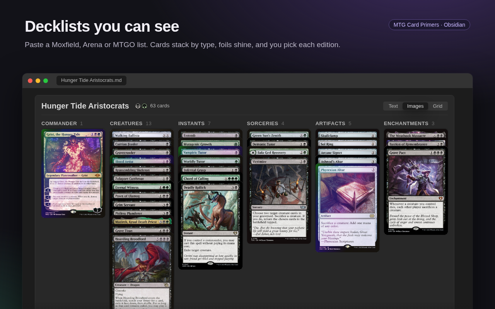
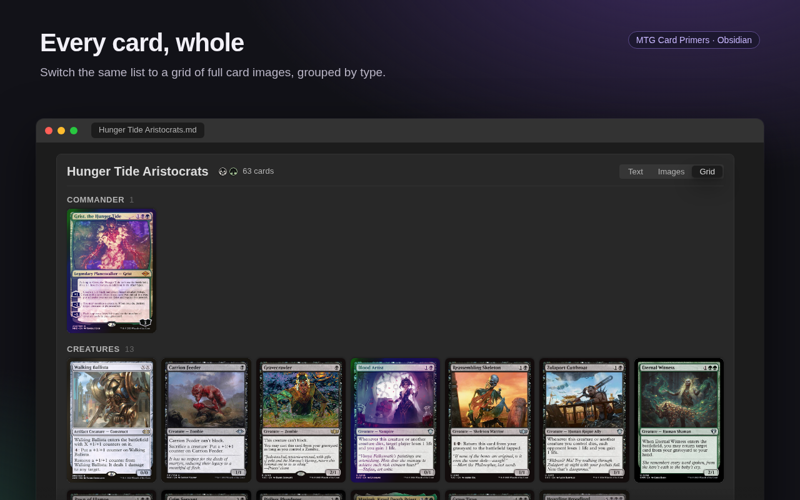
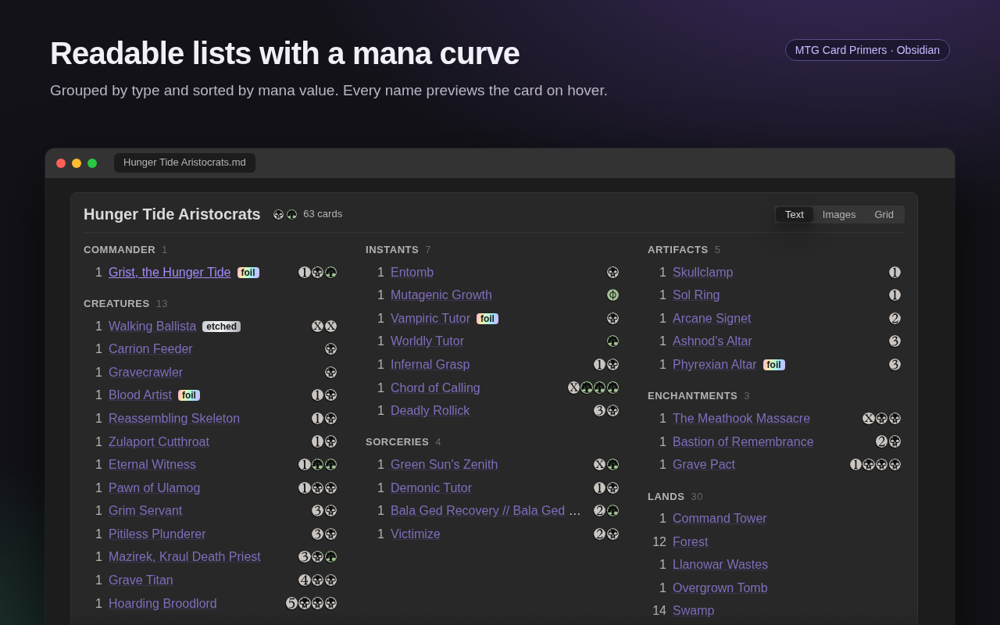
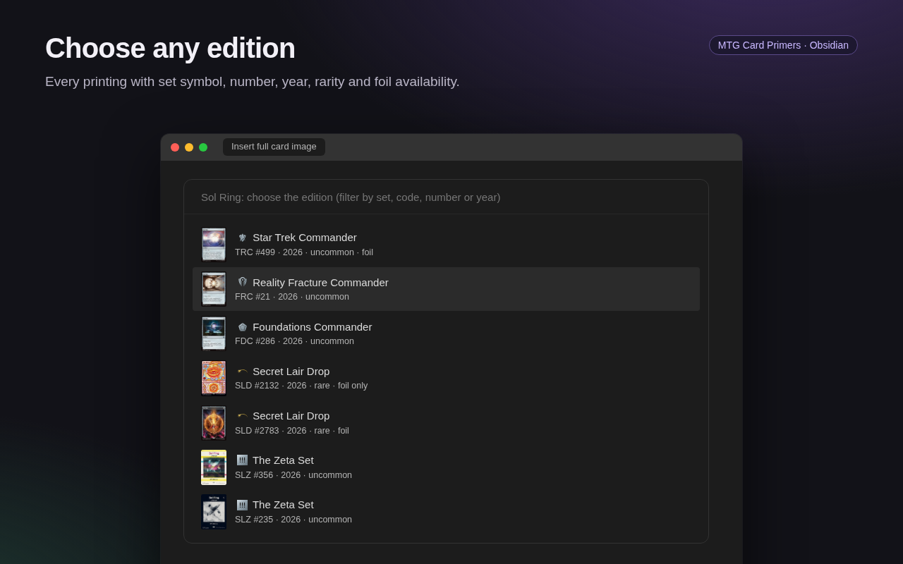

# Decklists: the `mtg-deck` block

Paste a decklist exported from Moxfield, Arena or MTGO inside an `mtg-deck` block:

````markdown
```mtg-deck
title: Hunger Tide Aristocrats
view: images

Commander
1 Grist, the Hunger Tide (DSC) 220 *F*

Deck
1 Sol Ring (C21) 263
1 Anel Solar
4 Swamp
4 Forest

Sideboard
1 Imperial Seal
```
````

The block has three views, chosen with the **Text | Images | Grid** buttons in its header:

- **Text:** cards in columns by type (Commander, Creatures, Instants…, Lands, Sideboard), sorted by mana value, with their mana cost. Hovering a name shows the card.
- **Images:** one stack per type; the cards overlap so only their name bars show. Hover a card to see it whole.
- **Grid:** every card whole, one grid per type.

| Images | Grid | Text | Edition picker |
|---|---|---|---|
|  |  |  |  |

**Sorting**

The **Sort** menu next to the view buttons groups the deck in one of four ways:

| Sort | Groups | Inside each group |
|---|---|---|
| **Type** (default) | Creatures, Planeswalkers, Instants, Sorceries, Artifacts, Enchantments, Lands | by mana value, then name |
| **Name** | one A–Z list | by name |
| **Mana value** | Mana value 0, 1, 2… 7+, then Lands | by name |
| **Color** | White, Blue, Black, Red, Green, Multicolor, Colorless, Lands | by mana value, then name |

The commander (and companion) always comes first. Sideboard and maybeboard stay separate, sorted the same way. Colour means the card's colours, not its colour identity (front face for double-faced cards).

**Opening primers from the deck**

- **Click** a card (its name in Text, the card in Images or Grid): its primer opens in a tab in the right sidebar, so you can edit it and keep looking at the deck. The sidebar opens if it was closed.
- **The panel is reused:** clicking another card shows that card's primer in the same tab. If you close the tab or move it out of the sidebar, the next click makes a new one.
- **No primer yet?** It is created with the card's data (your folder and template), like *New card primer*.
- **Ctrl/Cmd-click** opens the primer in a new tab instead.
- Cards that Scryfall couldn't find behave like a plain `[[link]]`.
- **Mobile:** the primer opens in the right drawer.

The header shows the deck's colour identity and card count; the footer shows the mana curve (lands not counted).

**List format**

- **Options** (optional, before the first card): `title:` (defaults to the commander's name), `view:` (`text`, `images` or `grid`) and `sort:` (`type`, `name`, `cmc` or `color`).
- **Sections:** `Commander`, `Companion`, `Deck`, `Sideboard`, `Maybeboard`, `Tokens`… also written `// Sideboard`, `SIDEBOARD:` or `Sideboard (15)`. Without headers, every card is in the deck, and cards after a blank line are the sideboard (Arena export). After the commander, a blank line starts the deck, so a `Deck` header is not needed (`Commander` / `1 Grist, the Hunger Tide` / blank line / the 99).
- **Card lines:** the same as the card search: `4 Name`, `4x Name`, `(SET) 123` for an exact edition, names in any language, typos.
- **Repeated lines** for the same card are added together. Lines that Scryfall can't find are listed in a warning.

**Changing the note from the block**

Two actions write into the block's text, so the note opens the same way next time:

- **Choosing a view or a sort** sets the `view:` or `sort:` line.
- **Choosing an edition:** in Images or Grid, hover a card and click its edition button (or right-click the card; long-press on mobile). The edition list is the same as in *Insert full card image*, and it says which editions exist in foil. The choice is written into the card's line as `(SET) 123`; quantity, name and markers are kept.

If the block can't be located safely (for example inside a callout, or the note was edited meanwhile), the view changes only on screen, and a notice shows the line to change by hand.

**Foils**

Add Moxfield's markers to the end of a card line: `*F*` for foil, `*E*` for etched foil. Images and Grid show a moving foil sheen on the card (still when the system reduces motion); Text shows a `foil` or `etched` tag. The same card in foil and non-foil stays on two lines.

---

[← Back to the README](../README.md)
