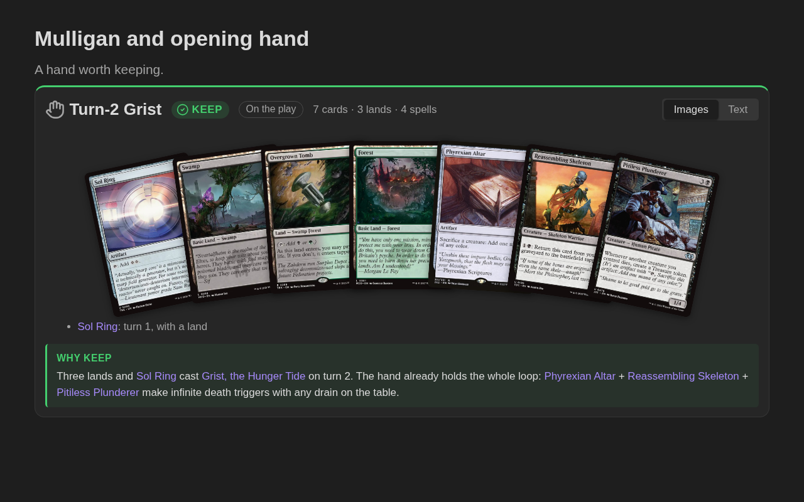
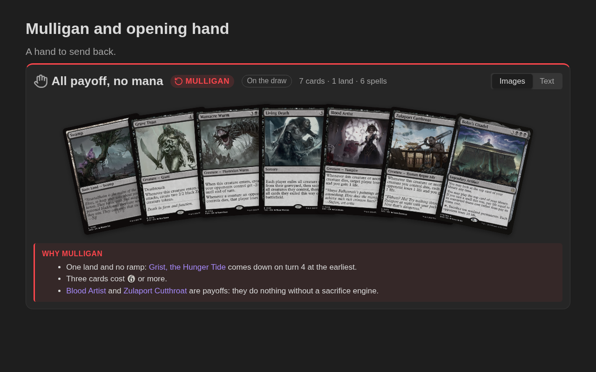

# Opening hands: the `mtg-hand` block

Shows an opening hand the way you hold it, fanned out, with the decision: **Keep** or **Mulligan**. Use it in a deck primer to show which hands to keep and which to send back, and why.

````markdown
```mtg-hand
title: Turn-2 Grist
keep
on the play
Sol Ring — turn 1, with a land
Swamp
Overgrown Tomb
Forest
Phyrexian Altar
Reassembling Skeleton
Pitiless Plunderer
why:
Three lands and [[Sol Ring]] cast [[Grist, the Hunger Tide]] on turn 2. The hand already holds the whole loop.
```
````



A hand to send back is drawn faded, with a red border and a red **Mulligan** badge:

````markdown
```mtg-hand
title: All payoff, no mana
mulligan
on the draw
Swamp
Grave Titan
Massacre Wurm
Living Death
Blood Artist
Zulaport Cutthroat
Bolas's Citadel
why:
- One land and no ramp: [[Grist, the Hunger Tide]] comes down on turn 4 at the earliest.
- Three cards cost {6} or more.
- [[Blood Artist]] and [[Zulaport Cutthroat]] are payoffs: they do nothing without a sacrifice engine.
```
````



The header counts the cards, lands and spells (`7 cards · 1 land · 6 spells`), the first thing to check before keeping. Click a card to open its primer, like in a decklist. **Images** / **Text** switches to two lists, Spells and Lands, with mana costs and hover previews; the choice is saved in the block as `view: text`.

## What to write

| Write | Means |
|---|---|
| `keep` | a hand to keep: green badge (also `keeper`, `manter`, `mantém`) |
| `mulligan` | a hand to send back: red badge, faded cards (also `mull`, `ship it`, `mulligar`) |
| `on the play` / `on the draw` | who starts (also `play: draw`, `jogando primeiro`, `jogando segundo`) |
| `Sol Ring` | a card, one per line |
| `2 Swamp`, `Swamp x2` | copies: each one is drawn in the fan |
| `Sol Ring — turn 1` | a note on the card, after ` — `, ` – ` or ` -- `, shown under the hand |
| `why:` | everything below it is the explanation, in Markdown (also `reason:`, `plan:`, `notes:`, `por quê:`, `motivo:`, `plano:`) |
| `title:` | the block's name (default *Opening hand*; also `título:`) |
| `view: text` | opens in the text view |

- **Cards** can be names, `[[links]]`, Moxfield lines (`1 Overgrown Tomb (GRN) 253` shows that edition) or names in another language. A list marker before them (`- Swamp`, `1. Swamp`) is ignored, so a hand pasted from a Markdown list works.
- **The explanation** after `why:` can span many lines and paragraphs, with lists, `[[links]]` (with hover previews) and mana symbols. It always goes last: every line after `why:` belongs to it.
- **Keep or mulligan is optional.** Without it the block is a plain hand, with a grey border.
- **Lines starting with `//`** are comments.

## In a deck primer

The default deck template starts the *Mulligan and opening hand* section with an `mtg-hand` block. Write one block per hand: a good hand and a bad one side by side teach more than either alone.

---

[← Back to the README](../README.md)
