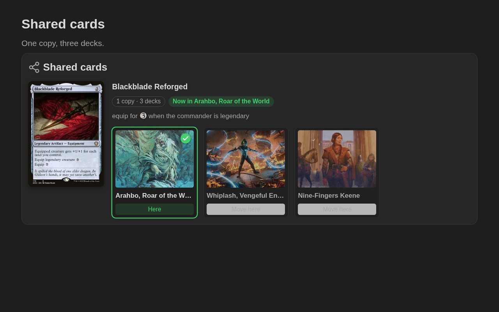

# Shared cards: the `mtg-shared` block

For the cards you own fewer copies of than the decks that play them. List the card, the decks that share it, and mark the deck that has it right now. When you move the card to another deck, click **Move here** and the note is updated.

````markdown
```mtg-shared
1 Blackblade Reforged — equip for {3} when the commander is legendary
- [x] Arahbo, Roar of the World
- [ ] Whiplash, Vengeful Engineer
- [ ] Nine-Fingers Keene
```
````



Each deck is shown with its commander's art. The deck that has the card has a green border and a check; the others are faded, with a **Move here** button. The header says how many copies you own and how many decks share it, and where the card is now.

## What to write

| Write | Means |
|---|---|
| `1 Blackblade Reforged` | the card, and how many copies you own (1 when not given) |
| `- [x] Arahbo, Roar of the World` | a deck that has the card now |
| `- [ ] Nine-Fingers Keene` | a deck that shares it but doesn't have it now |
| `- Whiplash, Vengeful Engineer` | a deck, with no checkbox (also `*`, `+` or `1.`) |
| `- Arahbo (here)` | also marks where the card is (`(now)`, `(aqui)`, `← aqui`) |
| `- [[Arahbo Primer\|Arahbo]]` | a link to the deck's note |
| `Card — note` | a note on the card, after ` — `, ` – ` or ` -- ` |
| `Card -> Deck A; Deck B; Deck C` | the decks on one line, after an arrow, split with `;` (commanders have commas in their names) |
| `title:` | the block's name (default *Shared cards*; also `título:`) |

Write several cards in the same block, each followed by its decks, to keep every shared card in one note. Lines starting with `//` are comments.

## Moving the card

- **One copy:** **Move here** marks that deck with `[x]` and every other deck with `[ ]`.
- **More copies:** each deck is switched on its own (**Add here** / **Here · remove**).
- **Too many decks:** if more decks are marked than the copies you own, the block warns *In 3 decks at once*.
- **Decks on one line** (`Card -> A; B`) become a list the first time you move the card, so each deck can hold its `[x]`.

If the block can't be updated (for example inside a callout), a message asks you to change the `[x]` by hand.

## Decks and their notes

A deck's name is usually its commander, so the block shows the commander's art. Clicking the art opens:

1. the note you linked (`[[Arahbo Primer]]`), or
2. the deck primer whose commander is that name (made with **New deck primer**), or
3. the commander's card primer.

A deck name that isn't a card (`Gates deck`) is shown with its name only.

---

[← Back to the README](../README.md)
