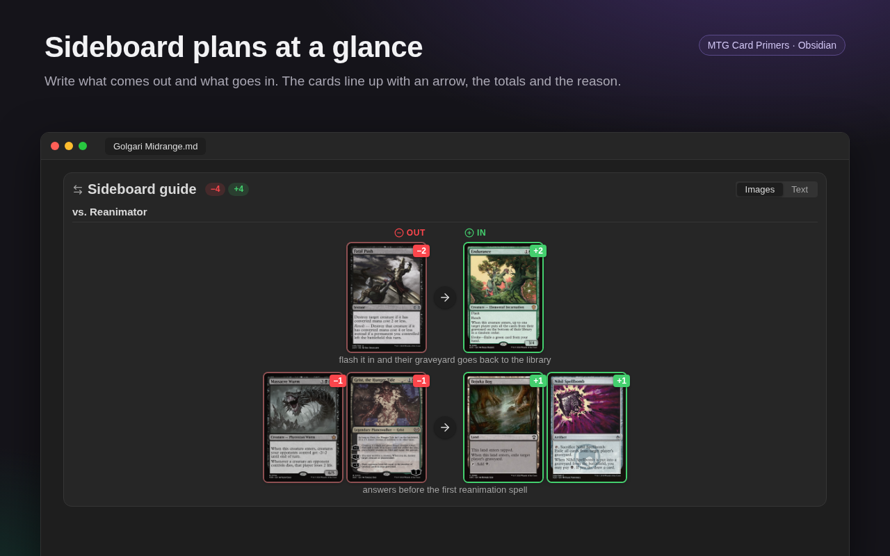
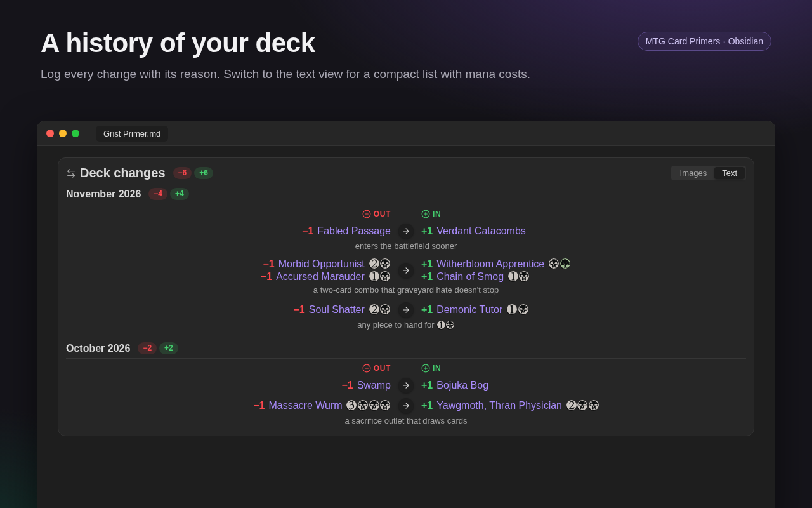

# Sideboard and deck changes

Shows what leaves the deck and what takes its place, with an arrow between them. Use `mtg-sideboard` for a sideboard guide (what to bring in for each matchup) and `mtg-changes` to log the changes you make to a deck. They work the same; only the default title differs (*Sideboard* or *Deck changes*).

````markdown
```mtg-sideboard
Fabled Passage -> Verdant Catacombs
```
````



The cards that come out are on the left, with a red border and `−1`; the ones that go in are on the right, with a green border and `+1`. The header adds them up (`−5 +5`) and warns when the deck ends bigger or smaller (`deck −1`). A block with only cuts, or only additions, shows just that side's total. Click a card to open its primer, like in a decklist. **Images** / **Text** switches to a compact list with mana costs and hover previews, and is saved in the block as `view: text`.

**One change per line**, with the arrow between what comes out and what goes in:

| Write | Means |
|---|---|
| `Fabled Passage -> Verdant Catacombs` | one out, one in (`→`, `=>` and ` > ` work too) |
| `Fabled Passage: -> Verdant Catacombs` | the same; a colon before the arrow is ignored |
| `2 Shock -> 2 Duress`, `2x Shock`, `Shock x2` | quantities |
| `Shock + Lightning Bolt -> Duress` | several cards on a side, joined by ` + ` or `;` |
| `Sol Ring ->` | only comes out |
| `-> Rest in Peace` | only goes in |
| `Shock -> Duress — the combo matchup` | the reason, after ` — `, ` – ` or ` -- `, shown under the change |

Cards can be names, `[[links]]` or Moxfield lines (`1 Thoughtseize (2XM) 107` shows that edition). Commas, hyphens and `//` stay in the name: `Kiki-Jiki, Mirror Breaker`, `Fire // Ice`. Lines starting with `//` are comments.

The reason belongs to the whole change, so `Chrome Mox + Mox Diamond -> — too slow` explains both cards at once. It is Markdown: `[[links]]` show the card on hover and `{1}{B}` becomes mana symbols.

**Moxfield-style lines.** `-1 Card` comes out and `+1 Card` goes in. Lines in a row make one change, until a blank line or a new `-` after the `+`:

````markdown
```mtg-changes
-1 Fabled Passage
-1 Evolving Wilds
+2 Verdant Catacombs
```
````

**`out:` / `in:` lists**, one card per line (or on the same line), until a blank line. Also accepted: `cut:`, `remove:` / `add:`, and in Portuguese `sai:`, `saem:`, `tira:` / `entra:`, `entram:`, `coloca:`.

````markdown
```mtg-sideboard
out:
2 Thoughtseize
Counterspell
in:
2 Kozilek's Return
Fire // Ice — kills mana dorks
```
````

**Groups.** A line ending with `:` (`vs. Aggro:`) or a Markdown heading (`## vs. Control`) starts a group with its own totals. Other lines become notes under the group, in Markdown with links and mana symbols. Leave a blank line before a note that follows an `out:`/`in:` list, or it is read as a card.

````markdown
```mtg-sideboard
title: Sideboard guide
vs. Aggro:
out: 2 Thoughtseize
Counterspell
in: 2 Kozilek's Return
Fire // Ice — kills mana dorks

vs. Control:
-2 Swords to Plowshares
+2 Mana Drain

Keep [[Teferi, Time Raveler]] in: it stops their instant-speed answers.
```
````

**Options:** `title:` (or `título:`) replaces the default title; `view: images` or `view: text` picks the view.

**Candidates.** Changes you are still weighing work the same way, as additions or cuts with no other side. Each list shows only its own total:

````markdown
```mtg-changes
title: Candidates to add
-> Demonic Tutor — any card to hand for {1}{B}
-> Witherbloom Apprentice + Chain of Smog — a two-card combo that graveyard hate doesn't stop
-> Chrome Mox + Mana Vault + Mox Diamond — fast mana
```
````

````markdown
```mtg-changes
title: Candidates to cut
Morbid Opportunist -> — draws one card a turn and is in no combo
Soul Shatter + Sheoldred's Edict -> — the deck has better removal
```
````

**A deck log.** In a deck primer, one group per update keeps the history of the list. In the text view it reads like a changelog:



````markdown
```mtg-changes
## 2026-11-08
Fabled Passage -> Verdant Catacombs — enters untapped sooner
Sol Ring ->
-> Rest in Peace — too many graveyard decks at the table

## 2026-10-20
-1 Swamp
+1 Bojuka Bog
```
````

**Good to know**

- **`-` and `+` at the start of a line are cards.** A Markdown list like `- keep the counters` is read as a card coming out. Write notes as plain lines, or after ` — ` on the change itself.
- **The tally doesn't read your decklist.** It counts only what is written in the block, so a list of 18 candidates to add and 6 to cut shows `deck +12`, a reminder of how many cuts are still missing.
- **Cards not found** on Scryfall are drawn with their name and listed under the block.

---

[← Back to the README](../README.md)
